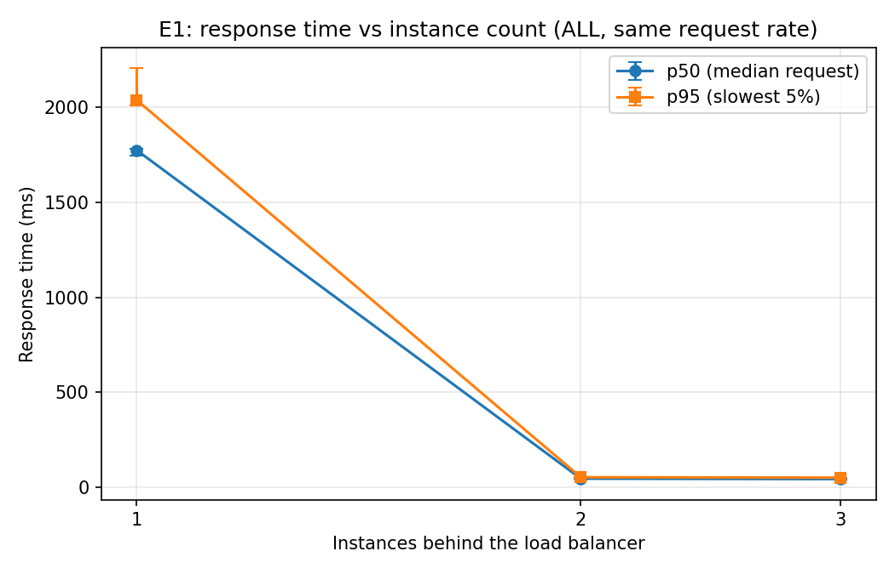
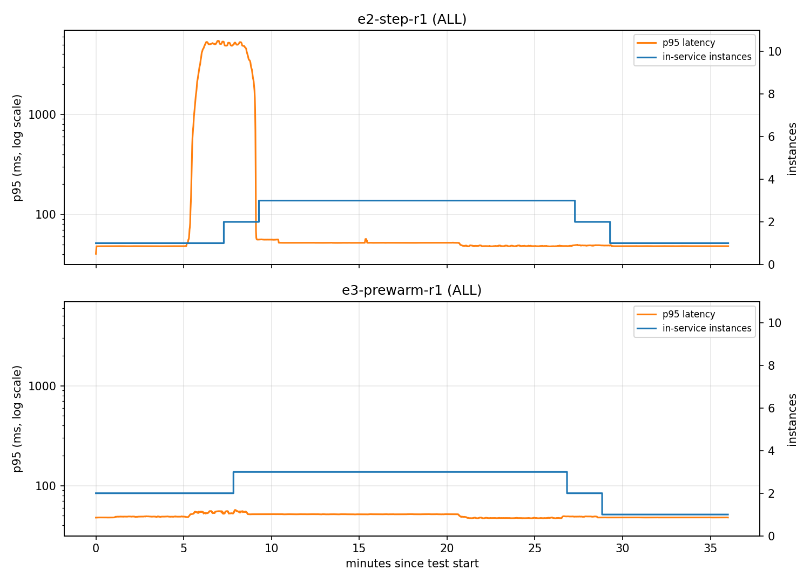
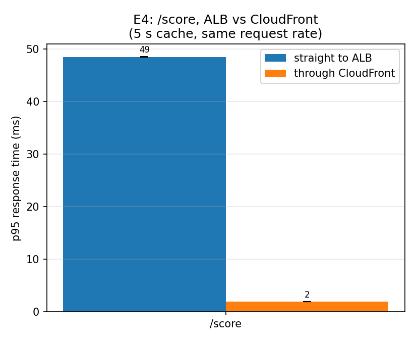
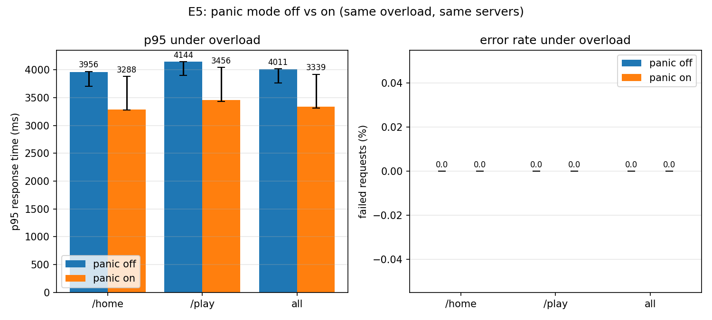

# Results

All numbers come from the real runs (6–8 Nov 2026): latency and errors from
`analysis/summary.csv` (`summarize.py`), costs from `analysis/cost.csv`
(`cost_per_run.py`), graphs from `docs/figures/` (`make_figures.py`), server
counts and ALB request counts from each run's `cloudwatch.csv`. Each number is
the **median of the runs** (5 for E1, 3 for the others), with the lowest–highest
run in brackets.

Setup for every run: c7i-flex.large app servers (2 vCPU, no CPU credits;
allowed on the AWS Free plan), k6 v2.2.0 on another c7i-flex.large in the
same region. Account limit: 8 vCPU, so at most 3 app servers next to k6. Unless noted, each k6 iteration is
one viewer journey: `/`, `/score`, `/play`, `/home` (`MIX=journey`). Raw k6 samples are aggregated per second on
the k6 box; whole-run percentiles come from every sample, not from averaging
per-second values.

## E1 – Latency vs instance count

Same request rate (250 journeys/s = 1,000 req/s, 15 min per run) against a fixed group of 1, 2 and 3 servers.
The rate was picked with 2-minute trials on 1 server: it completed about
170 journeys/s at most, so the E1 rate is set above that.

| Servers | p50 (ms) | p95 (ms) | p99 (ms) | Error rate |
|--------:|---------:|---------:|---------:|-----------:|
| 1 | 1,772 (1,744–1,781) | 2,036 (2,008–2,204) | 2,176 (2,144–2,352) | 0% |
| 2 | 46.6 (45.6–47.5) | 53.9 (52.7–54.9) | 59.9 (59.9–60.0) | 0% |
| 3 | 44.3 (44.1–45.3) | 51.9 (51.8–51.9) | 55.5 (54.1–55.8) | 0% |

**What it shows:** one server is overloaded: it completes only about 700 of the
1,000 req/s and every request waits in a queue (p95 about 2 s). A second server
takes the whole load and p95 falls about 38 times, to 54 ms. A third server adds
almost nothing (52 ms): once the CPU-bound `/play` work is spread out, what is
left is a fixed per-request cost. The ALB measured the app itself answering in
about 1–2 ms, so most of the remaining 44 ms is spent between the k6 box and
the servers (network and load balancer), not in our code.

## E2 – Reactive step scaling under a spike

Baseline 30 journeys/s (120 req/s) for 5 min, ramp to 300 journeys/s (1,200 req/s) in 30 s, hold 15 min, cool down
15 min. Policy: +1 server when average CPU > 50% for 1 min, −1 when < 20%
for 5 min, 1 to 3 servers.

| Measure | Value |
|---------|------:|
| Time from spike start to first new server in service | 148 (137–165) s |
| Time until p95 is back under 1 s | 240 (219–264) s |
| p95 during the first 2 min of the spike (median of per-second p95) | 4,177 (3,432–4,345) ms |
| Requests failed during the spike | 0% (0 errors in all 3 runs) |
| Most servers reached | 3 (the `asg_max`) |
| Boot time of one server (`measure_boot.py`, request → healthy) | 66.9 (65.7–69.6) s |

**What it shows:** reactive scaling works (1 → 3 servers, back to 1 after the
cool-down), but it is about 4 minutes late: the CPU alarm needs a full minute
above 50%, then each new server needs about 67 s to boot and pass health checks,
and it adds one server per step. During that gap p95 sits at 4–5 s. Nothing
failed: requests waited in the queue instead of being dropped.

## E3 – Predictive pre-warm

Same spike as E2; the floor is raised to 2 servers 5 minutes before it.

| Measure | E2 step | E3 pre-warm |
|---------|--------:|------------:|
| p95 during the first 2 min of the spike (ms, median of per-second p95) | 4,177 (3,432–4,345) | 52 (52–53) |
| Requests failed during the spike | 0 | 0 |
| Server-minutes used | 75 (71–76) | 83 (83–84) |
| App server cost for the run (USD, estimate) | 0.106 (0.100–0.107) | 0.117 (0.117–0.119) |

**What it shows:** pre-warming removes the gap completely: p95 never goes above
1 s and stays at E1's 52 ms floor through the spike. The price is about 11% more
server-minutes (about one cent per run here), spent on a server that waits for
the spike. That is Hotstar's approach: the match schedule is known, so capacity
is bought ahead. Step scaling still adds the third server under the spike load.

## E4 – CDN for cacheable responses

`/score` at 800 req/s (5 min per run), straight to the ALB vs through CloudFront (5 s cache).

| Path | p50 (ms) | p95 (ms) | Requests reaching the servers |
|------|---------:|---------:|------------------------------:|
| ALB direct | 44.1 (44.1–44.2) | 48.5 (48.5–48.5) | about 48,000 per minute (all of them) |
| CloudFront | 1.5 (1.5–1.5) | 1.9 (1.9–1.9) | 12 per minute (from the ALB `RequestCount`) |

**What it shows:** CloudFront answers about 29 times faster, from a nearby edge
location, and the servers see 12 requests a minute instead of 48,000: one origin
fetch per 5 s cache period, whatever the number of viewers. CloudFront's cache
statistics show 99.97% hits for the day. The catch: viewers can see a score up
to 5 s old, which is why only `/score` is cached.

## E5 – Panic mode (graceful degradation)

Overload of 500 journeys/s (2,000 req/s offered) on 2 fixed servers, panic flag off vs on. In panic mode
`/home` returns static rails instead of the personalised (CPU-heavy) ones.

| Endpoint | p95 off (ms) | p95 on (ms) | Errors off | Errors on |
|----------|-------------:|------------:|-----------:|----------:|
| `/home` | 3,956 (3,700–3,972) | 3,288 (3,276–3,880) | 4 | 2 |
| `/play` | 4,144 (3,903–4,148) | 3,456 (3,428–4,044) | 5 | 1 |
| all | 4,011 (3,764–4,020) | 3,339 (3,315–3,920) | 19 | 17 |

Errors are totals over the 3 runs (about 1.3 million requests with the flag off, 1.5 million with it on).
Completed requests: 1,425 (1,406–1,470) req/s off, 1,659 (1,655–1,726) req/s on.

**What it shows:** dropping the personalised `/home` work frees CPU: the same
two servers complete 16% more requests, the median request falls from 279 ms to
72 ms and `/play` p95 drops by about 17%. The servers are still overloaded
(p95 above 3 s), so panic mode buys headroom while scaling catches up; it does
not replace scaling. Errors stay negligible either way (under 0.005%).

## Cost

| | USD |
|--|----:|
| Total project spend before credits | $3.46 in the second account by 8 Nov 02:25 (AWS Budgets page); `cost_report.py` has no data because the `Project` cost allocation tag was never activated |
| Most expensive service | not measured (same reason) |
| App server cost per million requests, E1 with 3 servers (`cost.csv`, estimate) | 0.071 |
| App server cost of all 33 runs (`cost.csv`, estimate, E1 N=2 missing) | 1.23 |

## Limits of this study

- One region, synthetic traffic from one k6 box; real viewers are spread
  across India and mobile networks.
- Small scale: the account allows 8 vCPU, so at most 3 app servers. The
  curve and scaling behaviour are real, but the absolute numbers are tiny next
  to a real streaming fleet.
- c7i-flex.large servers have 2 vCPU (one physical core with two threads).
- 5 runs per E1 size and 3 for the other setups: enough for a median and a
  range, not for confidence intervals.
- The raw k6 samples were deleted with the results bucket, so the "first 2 min"
  p95 values are medians of per-second p95, not exact percentiles of that window.
- Server counts come from 1-minute CloudWatch data, so the E2 timing is ±60 s.
- E1 with 1 server ran in our first AWS account (same Terraform and server type);
  AWS later blocked that account, so everything else ran in a second one.
- The Auto Scaling metrics are missing for the E1 2-server runs, so their
  server-minutes and cost estimate are blank in `cost.csv`.
- E5 pair 3 ran six hours apart (panic off at 02:47, on at 08:57). Its
  panic-off p50 (1,052 ms) is the high end of that range.
